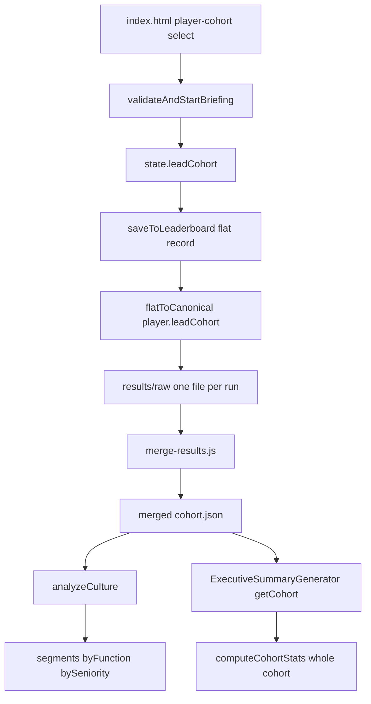

# LEAD Cohort Segmentation Design

**Status:** Design proposal (READ-ONLY investigation — no `.js` or `.html` changed)
**Scope:** `v2/` browser game — segment the company culture analysis and executive summary by the `leadCohort` field so the impact of the LEAD course can be seen.
**Supersedes:** any conflicting behaviour in the current implementation.

---

## 1. Purpose

The `leadCohort` field (blank / `2025` / `2026`) is captured on the sign-up form and stored on the run record, but is **not used for segmentation anywhere**. Its purpose is to let the organisation see the impact of the LEAD course by comparing:

- **2025 cohort** vs **2026 cohort** (year-on-year course impact), and
- **Course participants** (2025 + 2026) vs **non-participants** (blank).

This document specifies exactly how to segment the two consumers (culture analysis and executive summary) and how to keep the merge tool consistent.

---

## 2. Current State (Investigation Findings)

### 2.1 Where `leadCohort` is captured and stored

| Layer            | Location                                                         | Behaviour                                                                                                                                 |
| ---------------- | ---------------------------------------------------------------- | ----------------------------------------------------------------------------------------------------------------------------------------- |
| Form             | [`v2/index.html:154`](v2/index.html:154)                         | `<select id="player-cohort">` with options `""` (Select an option), `"2025"`, `"2026"`.                                                   |
| State capture    | [`v2/game-engine.js:702`](v2/game-engine.js:702)                 | `this.state.leadCohort = cohortInput ? cohortInput.value : "";` — non-blocking, blank allowed.                                            |
| Run record       | [`v2/game-engine.js:3603`](v2/game-engine.js:3603)               | `leadCohort: this.state.leadCohort` written into the flat record passed to `saveToLeaderboard()`.                                         |
| Canonical schema | [`v2/results-store.js:276`](v2/results-store.js:276)             | `player.leadCohort: str(f.leadCohort)` in [`flatToCanonical()`](v2/results-store.js:246).                                                 |
| Reverse mapping  | [`v2/results-store.js:363`](v2/results-store.js:363)             | `leadCohort: str(player.leadCohort)` in [`canonicalToFlat()`](v2/results-store.js:348).                                                   |
| Merge            | [`v2/tools/merge-results.js:223`](v2/tools/merge-results.js:223) | `cohort.json` is built from `merged.records` via `anonymiseForCulture`; `leadCohort` survives because it is part of the canonical record. |

**Conclusion:** the field round-trips correctly through the canonical schema and the merge tool. It is simply never _read_ for grouping.

### 2.2 Culture analysis — [`v2/culture-analysis.js`](v2/culture-analysis.js)

[`analyzeCulture(cohortData)`](v2/culture-analysis.js:70) returns:

```
{
  playerCount,
  metrics,        // calculateAggregateMetrics: growth/morale/attrition/profit + success/optimal counts
  leadership,     // analyzeLeadershipDistribution: aggregate style shares, diversity, mostUsed/leastUsed
  decisions,      // analyzeDecisionPatterns: aggressive/collaborative rates, info-seeking
  lead,           // analyzeLEADScores: per-dimension {avg, median, min, max, spread, consistency}
  colors,         // analyzePersonalityColors
  segments,       // analyzeSegments -> { byFunction, bySeniority }
  observations,   // generateObservations
  recommendations // generateRecommendations
}
```

**Existing segmentation** is in [`analyzeSegments()`](v2/culture-analysis.js:488):

```js
analyzeSegments(data) {
  return {
    byFunction: this.segmentBy(data, "jobFunction"),
    bySeniority: this.segmentBy(data, "seniority"),
  };
}
```

[`segmentBy(data, field)`](v2/culture-analysis.js:495) groups by `player[field] || "Not specified"` and, per group, returns:

```
{ name, count, avgGrowth, avgMorale, avgAttrition, dominantStyle, sufficient }
```

where `sufficient = count >= this.minSegmentSize` (3). **There is no cohort grouping.** The `minPlayers` gate is 3 ([`v2/culture-analysis.js:14`](v2/culture-analysis.js:14)).

**Consumers of `segments`:**

- [`generateObservations()`](v2/culture-analysis.js:690) — "Functional Differences" and "Seniority Differences" insights.
- [`generateRecommendations()`](v2/culture-analysis.js:832) — "Share Best Practice Between Functions".
- [`GameEngine._buildCultureReportHtml()`](v2/game-engine.js:4745) — sections 6 (By Business Function) and 7 (By Seniority).
- [`GameEngine.renderCultureDashboard()`](v2/game-engine.js:4953) — dashboard cards for function and seniority.

### 2.3 Executive summary — [`v2/executive-summary-generator.js`](v2/executive-summary-generator.js)

[`generateSummary()`](v2/executive-summary-generator.js:114) produces `summary` (1-page) + `detailed` (appendix) + `combined`.

**Executive summary sections** ([`generateExecutiveSummary()`](v2/executive-summary-generator.js:348)): Overall Assessment, Career Risks, Key Strengths, Critical Development Areas, Business Impact, Recommended Actions, Promotion Readiness.

**Detailed appendix** includes [`generateComparisonToBenchmarks()`](v2/executive-summary-generator.js:1659), which is the only cohort-facing comparison. It calls:

- [`getCohort()`](v2/executive-summary-generator.js:260) — filters `isCultureEligible`, maps `anonymiseForCulture`; **no cohort grouping**.
- [`computeCohortStats(cohort)`](v2/executive-summary-generator.js:1754) — returns `{ n, avgLEAD, leadership, excellence, maxStyle }` for the **whole** cohort; **no cohort grouping**.

The benchmark table compares the individual player against a single "JCB Cohort Avg (n=…)" column. **There is no cohort-vs-cohort comparison.**

### 2.4 Merge tool — [`v2/tools/merge-results.js`](v2/tools/merge-results.js)

- [`main()`](v2/tools/merge-results.js:102) collects JSON, calls [`Store.mergeRecords()`](v2/tools/merge-results.js:193).
- Writes `leaderboard.json`, `cohort.json` (culture-eligible + anonymised), `merge-manifest.json`.
- `cohort.json` records already carry `player.leadCohort`; the manifest has no cohort breakdown.

### 2.5 Data-flow diagram



---

## 3. Design Proposal

### 3.1 Canonical cohort values and shared predicate

Define the canonical set once in [`v2/results-store.js`](v2/results-store.js) (the single source of truth shared by browser and Node, mirroring `JCB_BUSINESS_FUNCTIONS`), and export it.

```js
// Valid LEAD course cohorts. Blank = not part of the course (non-participant).
const LEAD_COHORTS = ["2025", "2026"];

// Normalise any raw value to a canonical cohort key.
//   "2025" -> "2025"; "2026" -> "2026"; anything else / blank -> "" (none).
function normaliseCohort(value) {
  const v = str(value).trim();
  return LEAD_COHORTS.indexOf(v) !== -1 ? v : "";
}

// Read the cohort from either a canonical ({ player: { leadCohort } }) or a
// flat ({ leadCohort }) record. Returns "" when absent (legacy / non-participant).
function leadCohortOf(record) {
  if (!record) return "";
  if (isObject(record.player)) return normaliseCohort(record.player.leadCohort);
  return normaliseCohort(record.leadCohort);
}

// True when the record belongs to a LEAD course cohort (2025 or 2026).
function isCourseParticipant(record) {
  return leadCohortOf(record) !== "";
}
```

**Segment keys** (stable, used everywhere):

| Key        | Meaning                           | Membership                   |
| ---------- | --------------------------------- | ---------------------------- |
| `"2025"`   | 2025 LEAD course cohort           | `leadCohortOf(r) === "2025"` |
| `"2026"`   | 2026 LEAD course cohort           | `leadCohortOf(r) === "2026"` |
| `"none"`   | Not part of the course            | `leadCohortOf(r) === ""`     |
| `"course"` | All course participants (roll-up) | `isCourseParticipant(r)`     |

**Display labels:** `"2025 cohort"`, `"2026 cohort"`, `"Non-participants"`, `"All course participants"`.

**Exports to add** in the `return { … }` block at [`v2/results-store.js:939`](v2/results-store.js:939):

```js
LEAD_COHORTS: LEAD_COHORTS,
normaliseCohort: normaliseCohort,
leadCohortOf: leadCohortOf,
isCourseParticipant: isCourseParticipant,
```

**Browser wrappers** (delegating to `ResultsStore`, with local fallback) go alongside the existing predicates in [`v2/game-engine.js:224`](v2/game-engine.js:224) and [`v2/culture-analysis.js:24`](v2/culture-analysis.js:24) / [`v2/executive-summary-generator.js:195`](v2/executive-summary-generator.js:195).

> **Note on `flatToCanonical`:** [`v2/results-store.js:276`](v2/results-store.js:276) currently stores `str(f.leadCohort)` verbatim. Change it to `normaliseCohort(f.leadCohort)` so an unexpected value (e.g. `"2024"`) is stored as `""` rather than creating a phantom segment. This is a one-line, backwards-compatible change (blank stays blank).

### 3.2 Culture analysis segmentation

Add a per-cohort breakdown to [`analyzeCulture()`](v2/culture-analysis.js:70) so the impact of the course is visible.

**New method** `analyzeCohortSegments(data)` (place next to [`analyzeSegments()`](v2/culture-analysis.js:488)):

```js
analyzeCohortSegments(data) {
  const groups = { "2025": [], "2026": [], none: [] };
  data.forEach((p) => {
    const key = this.leadCohortOf(p) || "none";
    if (groups[key]) groups[key].push(p);
  });

  const build = (key, players) => {
    if (players.length === 0) return null;
    const lead = this.analyzeLEADScores(players);
    const metrics = this.calculateAggregateMetrics(players);
    const leadership = this.analyzeLeadershipDistribution(players);
    return {
      key: key,
      label: key === "none" ? "Non-participants" : key + " cohort",
      count: players.length,
      sufficient: players.length >= this.minSegmentSize,
      // LEAD dimension averages (the headline course-impact metrics)
      leadAvg: {
        leadership: lead.leadership.avg,
        excellence: lead.excellence.avg,
        agility: lead.agility.avg,
        determination: lead.determination.avg,
        total: (lead.leadership.avg + lead.excellence.avg +
                lead.agility.avg + lead.determination.avg),
      },
      // Balance: max single-style share (lower = more balanced)
      maxStyleShare: Math.max(0, ...Object.values(leadership.aggregate)),
      diversity: leadership.diversity,
      // Outcomes
      avgGrowth: metrics.avgGrowth,
      avgMorale: metrics.avgMorale,
      avgAttrition: metrics.avgAttrition,
      avgProfitMargin: metrics.avgProfitMargin,
      successRate: metrics.successRate,
      optimalRate: metrics.optimalRate,
    };
  };

  const byCohort = {
    "2025": build("2025", groups["2025"]),
    "2026": build("2026", groups["2026"]),
    none: build("none", groups.none),
  };

  // Roll-up: all course participants (2025 + 2026) vs non-participants.
  const coursePlayers = groups["2025"].concat(groups["2026"]);
  const course = build("course", coursePlayers);
  if (course) course.label = "All course participants";

  return {
    byCohort: byCohort,
    course: course,
    nonParticipants: byCohort.none,
    // Convenience deltas for the impact narrative (null when either side is
    // missing or below the minimum sample size).
    deltas: this.computeCohortDeltas(byCohort, course),
  };
}
```

**New method** `computeCohortDeltas(byCohort, course)` — returns `null` for any comparison where either side is missing or `sufficient === false`:

```js
computeCohortDeltas(byCohort, course) {
  const delta = (a, b) => {
    if (!a || !b || !a.sufficient || !b.sufficient) return null;
    return {
      leadTotal: b.leadAvg.total - a.leadAvg.total,
      leadership: b.leadAvg.leadership - a.leadAvg.leadership,
      excellence: b.leadAvg.excellence - a.leadAvg.excellence,
      agility: b.leadAvg.agility - a.leadAvg.agility,
      determination: b.leadAvg.determination - a.leadAvg.determination,
      balance: a.maxStyleShare - b.maxStyleShare, // +ve = b more balanced
      growth: b.avgGrowth - a.avgGrowth,
      morale: b.avgMorale - a.avgMorale,
      attrition: b.avgAttrition - a.avgAttrition, // -ve = b better
    };
  };
  return {
    // 2026 vs 2025 (year-on-year course impact)
    yoy: delta(byCohort["2025"], byCohort["2026"]),
    // 2026 vs non-participants
    cohort2026VsNone: delta(byCohort.none, byCohort["2026"]),
    // 2025 vs non-participants
    cohort2025VsNone: delta(byCohort.none, byCohort["2025"]),
    // All course participants vs non-participants (headline impact)
    courseVsNone: delta(byCohort.none, course),
  };
}
```

**Wire into the analysis object** at [`v2/culture-analysis.js:102`](v2/culture-analysis.js:102):

```js
segments: this.analyzeSegments(cohortData),
cohorts: this.analyzeCohortSegments(cohortData),   // NEW
```

**Metrics compared per cohort** (exact list):

1. LEAD dimension averages — `leadership`, `excellence`, `agility`, `determination`, and their `total`.
2. Balance — `maxStyleShare` (max single-style share; lower is more balanced) and `diversity` (entropy index).
3. Outcomes — `avgGrowth`, `avgMorale`, `avgAttrition`, `avgProfitMargin`.
4. Achievement — `successRate`, `optimalRate`.

**Observations** — add a "Course Impact" observation in [`generateObservations()`](v2/culture-analysis.js:543) (after the seniority insight, before the closing brace at line 727), only when `analysis.cohorts.deltas.courseVsNone` is non-null:

```js
const d =
  analysis.cohorts && analysis.cohorts.deltas
    ? analysis.cohorts.deltas.courseVsNone
    : null;
if (d) {
  analysis.observations.push({
    category: "Course Impact",
    headline:
      "Course participants average " +
      (d.leadTotal >= 0 ? "+" : "") +
      d.leadTotal.toFixed(0) +
      " LEAD points vs non-participants",
    detail:
      "Across " +
      analysis.cohorts.course.count +
      " course participants and " +
      analysis.cohorts.nonParticipants.count +
      " non-participants, the course group shows " +
      (d.balance >= 0 ? "+" : "") +
      d.balance.toFixed(0) +
      " points better style balance, " +
      (d.growth >= 0 ? "+" : "") +
      d.growth.toFixed(1) +
      "% growth and " +
      (d.morale >= 0 ? "+" : "") +
      d.morale.toFixed(0) +
      "% morale.",
  });
}
```

**Rendering** — add a "By LEAD Course Cohort" section to both renderers:

- [`GameEngine._buildCultureReportHtml()`](v2/game-engine.js:4745) — insert after section 7 (By Seniority, ends line 4799) and before section 8 (What the Data Shows, line 4801). Render a table with one row per cohort (`2025`, `2026`, Non-participants, All course participants) and columns: Leaders, LEAD avg, Balance (max style %), Growth, Morale, Attrition. Suppress rows where `sufficient === false` and show a footnote "Cohorts with fewer than 3 leaders are not shown."
- [`GameEngine.renderCultureDashboard()`](v2/game-engine.js:4953) — insert a matching `culture-section` with `culture-segment-grid` cards after the seniority block (ends line 4993).

### 3.3 Executive summary segmentation

Add a **cohort comparison section** to the detailed appendix, next to [`generateComparisonToBenchmarks()`](v2/executive-summary-generator.js:1659).

**New method** `computeCohortStatsByCohort(cohort)` — groups the already-filtered/anonymised cohort from [`getCohort()`](v2/executive-summary-generator.js:260) and reuses [`computeCohortStats()`](v2/executive-summary-generator.js:1754) per group:

```js
computeCohortStatsByCohort(cohort) {
  const groups = { "2025": [], "2026": [], none: [] };
  (cohort || []).forEach((p) => {
    const key = this.leadCohortOf(p) || "none";
    if (groups[key]) groups[key].push(p);
  });
  const course = groups["2025"].concat(groups["2026"]);
  return {
    "2025": this.computeCohortStats(groups["2025"]),
    "2026": this.computeCohortStats(groups["2026"]),
    none: this.computeCohortStats(groups.none),
    course: this.computeCohortStats(course),
    counts: {
      "2025": groups["2025"].length,
      "2026": groups["2026"].length,
      none: groups.none.length,
      course: course.length,
    },
  };
}
```

**New method** `generateCohortComparisonSection()` — returns an HTML `<div class="section">` (same markup conventions as [`generateComparisonToBenchmarks()`](v2/executive-summary-generator.js:1699)):

- **Heading:** `LEAD Course Impact — Cohort Comparison`
- **Table columns:** `Cohort | Leaders | Overall LEAD | Leadership | Excellence | Style Balance`
- **Rows:** `2025 cohort`, `2026 cohort`, `Non-participants`, `All course participants` — each row suppressed when `n < minCohortSize` (3).
- **Impact line** below the table (only when both sides meet the minimum):

  > "2026 cohort vs non-participants: +X LEAD, +Y style balance, +Z% growth (n=… vs n=…)."

- **Footnote:** states the minimum sample size and that blank cohort = not part of the course.

**Wire into the appendix** — call it from [`generateDetailedAppendix()`](v2/executive-summary-generator.js) immediately after the benchmark comparison is emitted, and add the resulting HTML to the returned string. (Locate the `generateComparisonToBenchmarks()` call site inside `generateDetailedAppendix()` and append `${this.generateCohortComparisonSection()}` after it.)

**Minimum sample size:** add `this.minCohortSize = 3;` to the constructor at [`v2/executive-summary-generator.js:42`](v2/executive-summary-generator.js:42), mirroring `CultureAnalysis.minSegmentSize`.

### 3.4 Course-impact framing

The comparison must make the course's impact **visible and meaningful** without over-claiming. Concrete framing:

- **Headline metric:** LEAD total delta (sum of the four dimension averages) — "Course participants average **+N LEAD points** vs non-participants."
- **Balance metric:** max-style-share delta — "**+N points better style balance**" (a lower max share means leaders use a wider repertoire).
- **Outcome metrics:** growth, morale, attrition deltas — "**+X% growth, +Y% morale, −Z% attrition**."
- **Year-on-year:** "**2026 cohort vs 2025 cohort: +N LEAD**" to show improvement between course years.
- **Narrative guardrails:**
  - Always show `n` for both sides so the reader can judge sample size.
  - Never present a delta when either side is below the minimum sample size — show "Insufficient data for a reliable comparison" instead.
  - Label the section as **descriptive, not causal** (consistent with the culture engine's stated design principle at [`v2/culture-analysis.js:4`](v2/culture-analysis.js:4)): "This compares observed outcomes between groups; it does not by itself establish that the course caused the difference."
  - Use the same sign convention everywhere: positive = better (so attrition delta is inverted, as in `computeCohortDeltas`).

### 3.5 Merge consistency

The merge tool must preserve `leadCohort` and let combined reports segment correctly.

1. **Preservation** — already works: `leadCohort` is part of the canonical record ([`v2/results-store.js:276`](v2/results-store.js:276)) and survives [`mergeRecords()`](v2/results-store.js:598) because it is carried through `canonicalToFlat`/`flatToCanonical` during normalisation. Change the store to `normaliseCohort(f.leadCohort)` so only canonical values survive.
2. **`cohort.json`** — no structural change needed; records already carry `player.leadCohort`. Reports that consume `cohort.json` will segment automatically once the analysis code reads the field.
3. **`merge-manifest.json`** — add a cohort breakdown to `totals` for transparency (in [`v2/tools/merge-results.js:249`](v2/tools/merge-results.js:249)):

   ```js
   cohortCounts: {
     "2025": merged.records.filter((r) => Store.leadCohortOf(r) === "2025").length,
     "2026": merged.records.filter((r) => Store.leadCohortOf(r) === "2026").length,
     none:   merged.records.filter((r) => Store.leadCohortOf(r) === "").length,
     course: merged.records.filter((r) => Store.isCourseParticipant(r)).length,
   }
   ```

4. **Console summary** — add a `cohorts:` line to the human-readable output (around [`v2/tools/merge-results.js:301`](v2/tools/merge-results.js:301)).
5. **Determinism** — the breakdown is a pure function of `merged.records`, so output stays byte-identical for the same input set.

### 3.6 Edge cases

| Case                                           | Behaviour                                                                                                                                                                                                                |
| ---------------------------------------------- | ------------------------------------------------------------------------------------------------------------------------------------------------------------------------------------------------------------------------ |
| **Blank cohort**                               | Treated as `"none"` (non-participant). Included in the "Non-participants" segment and in the course-vs-none comparison.                                                                                                  |
| **Cohort with too few members**                | `sufficient === false` when `count < minSegmentSize` (3). The segment is computed but **not rendered**, and any delta involving it is `null` (shows "Insufficient data").                                                |
| **Legacy records with no `leadCohort` field**  | `leadCohortOf()` returns `""` → treated as non-participant. No crash; no phantom segment.                                                                                                                                |
| **Unexpected value (e.g. `"2024"`)**           | `normaliseCohort()` maps it to `""` → non-participant. Prevents phantom segments.                                                                                                                                        |
| **All records are non-consenting**             | Unaffected: consent anonymisation happens before cohort grouping; cohort is retained on the record so segmentation still works.                                                                                          |
| **All records in one cohort (e.g. only 2026)** | Other segments are `null`; only the populated cohort renders; deltas are `null` and the impact line is suppressed.                                                                                                       |
| **No cohort data at all (all blank)**          | `byCohort["2025"]` and `byCohort["2026"]` are `null`; only "Non-participants" exists; no comparison section is rendered.                                                                                                 |
| **Mixed rounds within a cohort**               | `computeCohortStats()` already derives ratios per record using its own round divisor ([`v2/executive-summary-generator.js:1768`](v2/executive-summary-generator.js:1768)), so mixed-round cohorts compare like-for-like. |
| **A cohort below `minPlayers` (3) overall**    | `analyzeCulture()` returns its existing "Insufficient data" result before any cohort logic runs.                                                                                                                         |

### 3.7 Backwards compatibility

- **No cohort data present:** `analyzeCohortSegments()` returns `byCohort` with `null` entries and `deltas` all `null`. The culture report/dashboard simply omits the new section (guarded by `sufficient`/non-null checks). The executive summary omits the comparison section. Existing reports are unchanged.
- **Additive only:** the new `cohorts` key on the analysis object and the new `generateCohortComparisonSection()` output are additive; no existing field is removed or renamed.
- **Schema:** `player.leadCohort` already exists and defaults to `""`; switching to `normaliseCohort()` only rejects non-canonical values, which were never valid.
- **Merge output:** `cohortCounts` is an additive manifest field; existing consumers ignore unknown keys.

---

## 4. Implementation Checklist (for Code mode)

1. [`v2/results-store.js`](v2/results-store.js) — add `LEAD_COHORTS`, `normaliseCohort`, `leadCohortOf`, `isCourseParticipant`; use `normaliseCohort(f.leadCohort)` in [`flatToCanonical()`](v2/results-store.js:276); export the new helpers at [`v2/results-store.js:939`](v2/results-store.js:939).
2. [`v2/culture-analysis.js`](v2/culture-analysis.js) — add `leadCohortOf()` wrapper; add `analyzeCohortSegments()` + `computeCohortDeltas()`; wire `cohorts:` into [`analyzeCulture()`](v2/culture-analysis.js:102); add the "Course Impact" observation in [`generateObservations()`](v2/culture-analysis.js:543).
3. [`v2/game-engine.js`](v2/game-engine.js) — add `leadCohortOf()` wrapper near [`v2/game-engine.js:224`](v2/game-engine.js:224); add the "By LEAD Course Cohort" section to [`_buildCultureReportHtml()`](v2/game-engine.js:4745) and [`renderCultureDashboard()`](v2/game-engine.js:4953).
4. [`v2/executive-summary-generator.js`](v2/executive-summary-generator.js) — add `minCohortSize` to the constructor ([`v2/executive-summary-generator.js:42`](v2/executive-summary-generator.js:42)); add `leadCohortOf()`, `computeCohortStatsByCohort()`, `generateCohortComparisonSection()`; call the new section from `generateDetailedAppendix()` after [`generateComparisonToBenchmarks()`](v2/executive-summary-generator.js:1659).
5. [`v2/tools/merge-results.js`](v2/tools/merge-results.js) — add `cohortCounts` to the manifest `totals` ([`v2/tools/merge-results.js:249`](v2/tools/merge-results.js:249)) and a `cohorts:` console line.
6. Update [`v2/RESULTS_PERSISTENCE_DESIGN.md`](v2/RESULTS_PERSISTENCE_DESIGN.md) to document `player.leadCohort` and the cohort segmentation rules.

---

## 5. Open Questions for the Product Owner

1. Should the "course vs non-participants" comparison be the headline, or should 2025-vs-2026 be the headline? (Proposal: show both, with course-vs-none as the headline impact line.)
2. Minimum sample size for a cohort comparison — keep 3 (matching `minSegmentSize`), or raise it (e.g. 5) for a more reliable comparison? (Proposal: 3, configurable via `minCohortSize`.)
3. Should the executive summary cohort comparison appear in the 1-page summary or only the detailed appendix? (Proposal: detailed appendix only, to keep the summary player-focused.)
