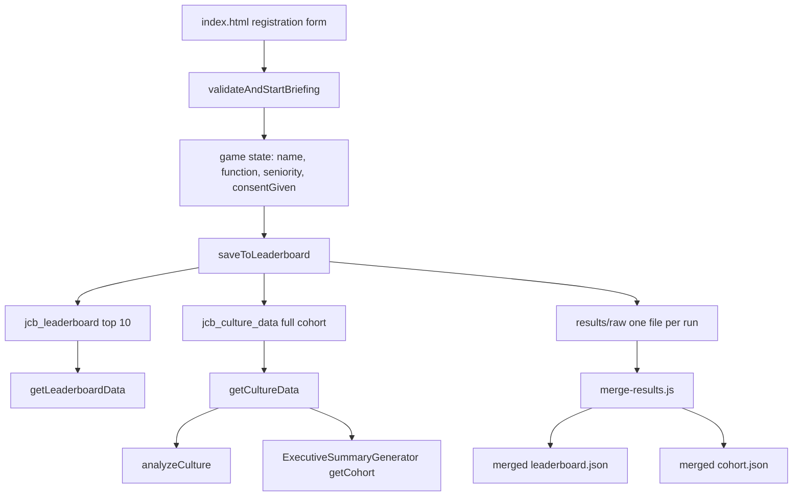

# Consent & Data-Segmentation Design

**Status:** Design proposal (READ-ONLY investigation — no code changed)
**Scope:** `v2/` browser game — consent to public display, and business-function segmentation for culture/executive reporting.
**Supersedes:** any conflicting behaviour in the current implementation.

---

## 1. Business Rules

### Rule 1 — Consent to public display

If a player does **not** consent to public display of their results:

- They **must still be able to play** the game normally.
- Their run **must be kept off the scoreboard / leaderboard**.
- Their run **may still be used** in the culture analysis and executive reports, but **anonymously**.

### Rule 2 — JCB business function required for culture analysis

If a player does **not** select a JCB business function:

- They **must still be able to play**.
- They **may still appear on the scoreboard** (unless they also declined consent).
- Their run **must be excluded** from the company culture analysis and executive reports.

### Combined truth table

| Consent | JCB business function? | Can play | On scoreboard | In culture / exec report |
| ------- | ---------------------- | -------- | ------------- | ------------------------ |
| Yes     | Yes                    | Yes      | Yes           | Yes (named)              |
| Yes     | No                     | Yes      | Yes           | No                       |
| No      | Yes                    | Yes      | No            | Yes (anonymous)          |
| No      | No                     | Yes      | No            | No                       |

---

## 2. Current State (Investigation Findings)

### 2.1 Registration form — [`v2/index.html`](v2/index.html)

- **Name:** [`#player-name`](v2/index.html:88)
- **Business function:** [`#player-function`](v2/index.html:101) — a `<select>` whose first option is a blank default `value=""` labelled "Select your function", followed by 15 options. Several options are **not** JCB business functions: `Student`, `Academic`, `Consultant`, `Other Industry`, `Other`.
- **Seniority:** [`#player-seniority`](v2/index.html:122)
- **Leadership style:** radios `name="leadership-style"` (lines 154–231)
- **Consent checkbox — ALREADY EXISTS** at [`v2/index.html:234`](v2/index.html:234):

  ```html
  <div class="form-group">
    <label class="checkbox-label">
      <input type="checkbox" id="consent-checkbox" />
      I consent to my results being displayed publicly
    </label>
  </div>
  ```

- **BEGIN button:** [`onclick="game.validateAndStartBriefing()"`](v2/index.html:241)

### 2.2 Form validation — [`v2/game-engine.js:553`](v2/game-engine.js:553) `validateAndStartBriefing()`

The current code reads `#player-name`, `#player-function`, `#player-seniority`, and `#consent-checkbox`, then **blocks non-consenting players**:

```js
if (!consentCheckbox.checked) {
  alert("Please consent to public results display");
  return;
}
...
this.state.consentGiven = true;
```

**This directly contradicts Rule 1.** Consent is currently a hard gate to play; it must instead be a recorded preference that only affects scoreboard visibility.

### 2.3 State — [`v2/game-engine.js:11`](v2/game-engine.js:11)

The constructor already tracks `playerName`, `jobFunction`, `seniority`, `selfIdentifiedStyle`, `consentGiven: false`, `round`, `runId`. So `consentGiven` already exists in state — it just needs to be carried into the persisted record.

### 2.4 Persistence — two `localStorage` keys

- `jcb_leaderboard` — top-10 display slice, read by [`getLeaderboardData()`](v2/game-engine.js:192).
- `jcb_culture_data` — full cohort, read by [`getCultureData()`](v2/game-engine.js:211).

Write path: [`saveToLeaderboard(playerData)`](v2/game-engine.js:292) assigns a `runId`, appends to the full cohort (`jcb_culture_data`, idempotent by `runId`), appends to `jcb_leaderboard`, sorts via [`compareLeaderboardRecords()`](v2/game-engine.js:84), slices top 10, computes rank against the full cohort, then calls [`persistRunToResultsFolder()`](v2/game-engine.js:368) → `window.ResultsStore.recordAndPersist`.

[`reconcileCultureData()`](v2/game-engine.js:229) back-fills the culture store from the leaderboard by `runId` or the legacy key `timestamp|name` ([`legacyRecordKey()`](v2/game-engine.js:287)).

### 2.5 Canonical schema — [`v2/results-store.js:173`](v2/results-store.js:173) `flatToCanonical()`

Builds a nested record:

```
player:    { name, jobFunction, seniority, selfIdentifiedStyle }
run:       { round, escaped, optimal, adaptationBonus }
outcomes:  { growth, morale, attrition, profitMargin, organizationalCapability }
lead:      { ... }
profile:   { ... }
narrative: { ... }
history:   { ... }
integrity: { recordHash }
```

**There is no consent field.** [`canonicalToFlat()`](v2/results-store.js:261) is the reverse mapping. [`compareRecords()`](v2/results-store.js:430) defines the strict total order (`growth DESC, leadTotal DESC, timestamp ASC, runId ASC`). [`mergeRecords()`](v2/results-store.js:502) dedupes by `runId` (legacy fallback `timestamp|name`) and resolves conflicts. [`toLeaderboardEntry()`](v2/results-store.js:534) projects a record to a leaderboard row.

### 2.6 Culture analysis — [`v2/culture-analysis.js:19`](v2/culture-analysis.js:19) `analyzeCulture(cohortData)`

- Requires `cohortData.length >= this.minPlayers` (3).
- **Applies no filtering whatsoever** — it consumes the entire cohort array.
- [`analyzeSegments()`](v2/culture-analysis.js:424) → [`segmentBy()`](v2/culture-analysis.js:431) segments by `jobFunction` and `seniority`, using `player[field] || "Not specified"`. So players with no function currently land in a `"Not specified"` segment and are counted.

### 2.7 Executive summary — [`v2/executive-summary-generator.js`](v2/executive-summary-generator.js)

- [`getCohort()`](v2/executive-summary-generator.js:182) reads from `cultureDataProvider` or `localStorage["jcb_culture_data"]` — **no filtering**.
- [`computeCohortStats(cohort)`](v2/executive-summary-generator.js:1669) computes `n`, `avgLEAD`, `leadership`, `excellence`, `maxStyle` — **no filtering**.
- [`findPriorRound1Record()`](v2/executive-summary-generator.js:205) matches by name.

### 2.8 Merge tool — [`v2/tools/merge-results.js`](v2/tools/merge-results.js)

- [`main()`](v2/tools/merge-results.js:102) collects raw JSON files, calls [`Store.mergeRecords(allRecords)`](v2/tools/merge-results.js:193).
- Builds `leaderboardEntries` from `merged.records.slice(0, top)` (lines 198–200).
- Writes `leaderboard.json`, `cohort.json`, `merge-manifest.json`.
- **No consent or segmentation filtering.**

### 2.9 Data-flow diagram



---

## 3. Design Proposal

### 3.1 New fields on the canonical run record

Add a single `consent` object to the canonical schema in [`flatToCanonical()`](v2/results-store.js:173), and mirror it in [`canonicalToFlat()`](v2/results-store.js:261):

```js
consent: {
  publicDisplay: Boolean,   // default: false
  capturedAt: String        // ISO 8601 timestamp, default: record timestamp
}
```

- **`consent.publicDisplay`** — `true` only when the player ticked the box. **Default `false`** (fail-safe: absence of consent means not public).
- **`consent.capturedAt`** — when consent was captured, for auditability.

**Business function:** reuse the existing `player.jobFunction` field. Do **not** add a new field. Instead add a derived helper that classifies whether the value is a JCB business function.

Add a shared constant (in [`v2/results-store.js`](v2/results-store.js) so both browser and merge tool can use it):

```js
const JCB_BUSINESS_FUNCTIONS = [
  "Engineering",
  "Manufacturing",
  "Commercial",
  "Finance",
  "Human Resources",
  "Operations",
  "Product Development",
  "Marketing",
  "IT / Digital",
];
```

And a predicate:

```js
function hasJcbBusinessFunction(record) {
  const fn = record && record.player && record.player.jobFunction;
  return JCB_BUSINESS_FUNCTIONS.indexOf(fn) !== -1;
}
```

> **Decision point for the product owner:** the dropdown currently also offers `Student`, `Academic`, `Consultant`, `Other Industry`, `Other`. These are treated as **non-JCB** and therefore excluded from culture/exec. If any of these should count, add them to `JCB_BUSINESS_FUNCTIONS`.

### 3.2 Consent UI

The checkbox already exists at [`v2/index.html:234`](v2/index.html:234). Changes required:

1. **Wording** — make the consequence explicit:

   ```html
   <label class="checkbox-label">
     <input type="checkbox" id="consent-checkbox" />
     I consent to my name and results being shown on the public scoreboard. If I
     do not tick this, I can still play, but my results will not appear on the
     scoreboard. My anonymous results may still be included in company culture
     analysis.
   </label>
   ```

2. **Default** — unchecked (`consent.publicDisplay` defaults to `false`).

3. **Reading** — in [`validateAndStartBriefing()`](v2/game-engine.js:553), replace the blocking check with a non-blocking capture:

   ```js
   // REMOVE the blocking block:
   // if (!consentCheckbox.checked) { alert(...); return; }

   this.state.consentGiven = !!(consentCheckbox && consentCheckbox.checked);
   ```

   Keep the existing validation for name, function, seniority, and leadership style. **Do not** require the checkbox.

4. **Optional UX nicety** — when the box is unchecked, show a small inline note near BEGIN: "You can still play. Your results will be kept off the scoreboard." This is optional and does not affect logic.

### 3.3 Scoreboard filtering

The scoreboard must exclude runs where `consent.publicDisplay === false`. Apply the filter at **all three** points so live and merged views agree.

**Predicate (shared):**

```js
function isPubliclyDisplayable(record) {
  return !!(record && record.consent && record.consent.publicDisplay === true);
}
```

**a) Write path — [`saveToLeaderboard()`](v2/game-engine.js:292)**

- Always append the run to the **full cohort** (`jcb_culture_data`) — needed for anonymous culture analysis.
- Only append to `jcb_leaderboard` when `isPubliclyDisplayable(record)` is true.
- Rank computation: compute rank **only against publicly displayable records** (otherwise a non-consenting player would consume a rank slot invisibly). If the player is not publicly displayable, return a placement object with `rank: null` and a flag such as `hidden: true` so [`showLeaderboardPlacement()`](v2/game-engine.js:3522) can show "Your results are private and not shown on the scoreboard."

**b) Read path — [`getLeaderboardData()`](v2/game-engine.js:192)**

- After parsing `jcb_leaderboard`, defensively filter with `isPubliclyDisplayable`. This protects against legacy data written before the rule existed.

**c) Merge tool — [`v2/tools/merge-results.js`](v2/tools/merge-results.js)**

- When building `leaderboardEntries` (lines 198–200), filter `merged.records` with `isPubliclyDisplayable` **before** `.slice(0, top)`.

**d) Reconciliation — [`reconcileCultureData()`](v2/game-engine.js:229)**

- No change to inclusion (culture store keeps everyone), but ensure the back-fill copies the `consent` object so the filter works on reconciled records.

### 3.4 Culture / executive filtering + anonymity

Two independent filters:

1. **Include** non-consenting players, but **anonymise** them.
2. **Exclude** players with no JCB business function.

**Anonymisation function (shared):**

```js
function anonymiseForCulture(record) {
  const clone = JSON.parse(JSON.stringify(record));
  if (!isPubliclyDisplayable(clone)) {
    clone.player.name = "Anonymous";
    // strip any other identifying fields
    if (clone.narrative) {
      delete clone.narrative.playerName;
      delete clone.narrative.quotes;
    }
    clone.anonymised = true;
  }
  return clone;
}
```

**Stripped fields for non-consenting players:**

- `player.name` → replaced with `"Anonymous"`.
- Any name echoed inside `narrative` (e.g. `narrative.playerName`, free-text quotes) → removed.
- **Retained:** `player.jobFunction`, `player.seniority`, `player.selfIdentifiedStyle`, all `outcomes`, `lead`, `profile`, `run`, `history`. Function is retained because it is required for segmentation and is not, on its own, identifying.

**Segmentation filter (shared):**

```js
function isCultureEligible(record) {
  return hasJcbBusinessFunction(record);
}
```

**Where applied:**

**a) [`getCultureData()`](v2/game-engine.js:211)** — add a new accessor `getCultureDataForAnalysis()` that:

1. Reads the full cohort.
2. Filters with `isCultureEligible`.
3. Maps with `anonymiseForCulture`.

Keep `getCultureData()` returning the raw cohort for admin/export use, but point analysis consumers at the new accessor.

**b) [`analyzeCulture()`](v2/culture-analysis.js:19)** — accept the already-filtered/anonymised array. As a defensive measure, also apply `isCultureEligible` at the top of the method so it is safe if called directly. The `minPlayers = 3` check then runs against the eligible set.

**c) [`ExecutiveSummaryGenerator.getCohort()`](v2/executive-summary-generator.js:182)** — apply the same filter + anonymise pipeline before returning. [`computeCohortStats()`](v2/executive-summary-generator.js:1669) then operates on the clean set.

**d) Merge tool cohort output** — when writing `cohort.json`, filter with `isCultureEligible` and map with `anonymiseForCulture`.

**e) [`analyzeSegments()`](v2/culture-analysis.js:424)** — after the above, the `"Not specified"` bucket should no longer receive non-JCB players, because they are filtered out upstream. Keep the `|| "Not specified"` fallback for safety.

### 3.5 Anonymity mechanics

- Anonymity is applied **only** to non-consenting players, and **only** in the culture/exec pipeline. The raw record in `results/raw/` and the full cohort in `jcb_culture_data` retain the real name (needed for the player's own feedback and for re-import/merge integrity).
- The `anonymised: true` flag travels with the record so downstream reports can state "includes N anonymous responses".
- Function and seniority are retained; name and free-text identity are removed. This is the minimum needed for segmentation while preventing identity leakage.
- **Small-cell risk:** if a segment (function × seniority) has fewer than `minSegmentSize` (3) members, the existing segment logic already suppresses it. Confirm this suppression still applies after filtering, and consider raising the threshold for anonymous-only segments to avoid re-identification in tiny groups.

### 3.6 Merge consistency

The merge tool must apply the **same** rules as the browser so merged outputs match live views:

1. Import the shared predicates from `results-store.js` (`isPubliclyDisplayable`, `hasJcbBusinessFunction`, `isCultureEligible`, `anonymiseForCulture`).
2. **`leaderboard.json`** — filter `isPubliclyDisplayable` before slicing to `top`.
3. **`cohort.json`** — filter `isCultureEligible`, then map `anonymiseForCulture`.
4. **`merge-manifest.json`** — add counts for transparency:

   ```js
   totals: {
     records: merged.records.length,
     publicDisplay: <count where isPubliclyDisplayable>,
     hiddenFromScoreboard: <count where !isPubliclyDisplayable>,
     cultureEligible: <count where isCultureEligible>,
     excludedNoFunction: <count where !isCultureEligible>,
     anonymised: <count where !isPubliclyDisplayable && isCultureEligible>
   }
   ```

5. Because `mergeRecords()` dedupes by `runId`, ensure the `consent` object is part of the canonical record so it survives merge and conflict resolution.

### 3.7 Edge cases

| Case                                           | Behaviour                                                                                                                                                                                                                                                                                                                                                              |
| ---------------------------------------------- | ---------------------------------------------------------------------------------------------------------------------------------------------------------------------------------------------------------------------------------------------------------------------------------------------------------------------------------------------------------------------- |
| **Declines consent AND no business function**  | Can play. Off scoreboard. Excluded from culture/exec.                                                                                                                                                                                                                                                                                                                  |
| **Consents but no business function**          | Can play. On scoreboard. Excluded from culture/exec.                                                                                                                                                                                                                                                                                                                   |
| **Declines consent but has business function** | Can play. Off scoreboard. Included in culture/exec anonymously.                                                                                                                                                                                                                                                                                                        |
| **Legacy record with no `consent` field**      | Treat as `publicDisplay: false` (fail-safe). It will be hidden from the scoreboard and anonymised in culture/exec. **Recommendation:** for legacy records already displayed, consider a one-time migration that sets `publicDisplay: true` for records created before the rule, to avoid retroactively hiding existing scoreboard entries. This is a product decision. |
| **Legacy record with no `jobFunction`**        | Treated as non-JCB → excluded from culture/exec.                                                                                                                                                                                                                                                                                                                       |
| **All players in a cohort decline consent**    | Culture analysis still runs on anonymised data (if ≥3 eligible). Scoreboard is empty; show an empty-state message.                                                                                                                                                                                                                                                     |
| **Fewer than 3 culture-eligible players**      | `analyzeCulture()` returns its existing "insufficient data" result.                                                                                                                                                                                                                                                                                                    |
| **Player re-imports / merges their own run**   | Dedupe by `runId` keeps one record; `consent` travels with it.                                                                                                                                                                                                                                                                                                         |
| **Consent changed on a later round**           | Each run is a separate record with its own `consent`. A player could consent in Round 1 and decline in Round 2; each run is filtered independently.                                                                                                                                                                                                                    |

---

## 4. Implementation Checklist (for the Code mode)

1. [`v2/results-store.js`](v2/results-store.js) — add `JCB_BUSINESS_FUNCTIONS`, `hasJcbBusinessFunction`, `isPubliclyDisplayable`, `isCultureEligible`, `anonymiseForCulture`; add `consent` to `flatToCanonical()` and `canonicalToFlat()`; export the new helpers.
2. [`v2/index.html`](v2/index.html) — update consent checkbox wording (lines 234–239).
3. [`v2/game-engine.js`](v2/game-engine.js) — remove the blocking consent check in `validateAndStartBriefing()` (line 553) and capture `consentGiven`; filter in `saveToLeaderboard()` (line 292) and `getLeaderboardData()` (line 192); add `getCultureDataForAnalysis()`; carry `consent` through `reconcileCultureData()` (line 229).
4. [`v2/culture-analysis.js`](v2/culture-analysis.js) — defensive `isCultureEligible` filter at the top of `analyzeCulture()` (line 19).
5. [`v2/executive-summary-generator.js`](v2/executive-summary-generator.js) — filter + anonymise in `getCohort()` (line 182).
6. [`v2/tools/merge-results.js`](v2/tools/merge-results.js) — filter leaderboard and cohort outputs; extend `merge-manifest.json` totals.
7. Update [`v2/RESULTS_PERSISTENCE_DESIGN.md`](v2/RESULTS_PERSISTENCE_DESIGN.md) to document the `consent` field and the segmentation rules.

---

## 5. Open Questions for the Product Owner

1. Should `Student`, `Academic`, `Consultant`, `Other Industry`, `Other` count as JCB business functions for culture analysis? (Proposal: no.)
2. For legacy records with no `consent` field, should they be hidden from the scoreboard (fail-safe) or grandfathered as public? (Proposal: grandfather existing, fail-safe for new.)
3. Should the scoreboard show a count of hidden/private runs, or remain silent about them? (Proposal: silent, with a private-placement message for the player.)
