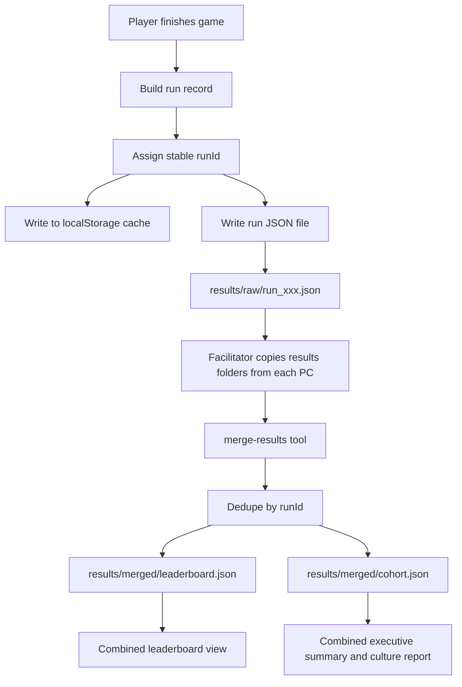
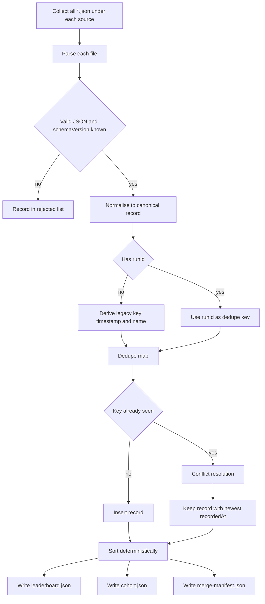

# Results Persistence & Amalgamation — Design Proposal

**Status:** Proposal for review (no code changed)
**Scope:** `v2/` leadership training game
**Author:** Architect mode
**Date:** 2026-09-13

---

## 1. Executive Summary

Today every result lives **only in the browser's `localStorage`** on the machine that
played the game. That produces three problems the product owner has identified:

1. **Inconsistent leaderboards** — each PC has its own private `localStorage`, so two
   people on two laptops never see each other's scores.
2. **No durable results folder** — clearing the browser cache, using a different
   browser, or a private/incognito window silently wipes the history.
3. **No amalgamation** — there is no way to combine the results gathered on several
   computers into one leaderboard and one executive summary.

This document proposes a **portable, mergeable results file format**, a **write path**
that works for a non-technical facilitator, and a **merge tool** that de-duplicates and
combines results from any number of machines into a single leaderboard and a single
culture/executive report.

The design is deliberately **additive**: the existing `localStorage` flow keeps working
as a cache, and the new file-based flow becomes the source of truth.

---

## 2. Current Persistence Model (Investigation Findings)

### 2.1 Where results live

All persistence is in [`v2/game-engine.js`](v2/game-engine.js:159) via two `localStorage`
keys. There is **no file I/O, no server, no IndexedDB, no fetch** anywhere in `v2/`.

| Key                | Written by                                     | Contents                                    | Size         |
| ------------------ | ---------------------------------------------- | ------------------------------------------- | ------------ |
| `jcb_leaderboard`  | [`saveToLeaderboard()`](v2/game-engine.js:259) | Top-10 slice, sorted by `growth` descending | ≤ 10 records |
| `jcb_culture_data` | [`saveToLeaderboard()`](v2/game-engine.js:259) | **Full cohort** — every completed run       | unbounded    |

Read paths:

- [`getLeaderboardData()`](v2/game-engine.js:159) → `JSON.parse(localStorage.getItem("jcb_leaderboard"))`
- [`getCultureData()`](v2/game-engine.js:178) → calls [`reconcileCultureData()`](v2/game-engine.js:196) then reads `jcb_culture_data`
- [`reconcileCultureData()`](v2/game-engine.js:196) back-fills the culture store from the
  leaderboard, matching by `runId` or the legacy key `timestamp + "|" + name`
  ([`legacyRecordKey()`](v2/game-engine.js:254)).

### 2.2 The write path

The single write happens in [`showFeedback()`](v2/game-engine.js:3209), which calls
[`saveToLeaderboard(playerData)`](v2/game-engine.js:259). Idempotency is guarded by
`this._savedRunIds` (a `Set` of `runId`s) so a run is written exactly once.

`runId` is generated as:

```js
"run_" +
  Date.now().toString(36) +
  "_" +
  Math.random().toString(36).slice(2, 10);
```

Leaderboard ordering is `leaderboard.sort((a, b) => b.growth - a.growth)` — a
**non-deterministic tie-break** (equal `growth` values keep insertion order, which
differs per machine). This is one root cause of "inconsistent" leaderboards.

### 2.3 The exact record shape

The object passed to [`saveToLeaderboard()`](v2/game-engine.js:3266) is the de-facto
schema. Every field below is already produced today:

```jsonc
{
  "name": "string",
  "jobFunction": "string",
  "seniority": "string",

  "growth": 0.0, // percent
  "morale": 0.0, // percent
  "attrition": 0.0, // percent
  "profitMargin": 0.0, // percent

  "leadership": 0, // LEAD dimension points
  "excellence": 0,
  "agility": 0,
  "determination": 0,
  "organizationalCapability": 0,

  "leadershipStyle": "string", // dominant Goleman style name
  "leadershipProfile": {}, // full style distribution
  "leadershipStyles": {}, // raw style points (6 Goleman styles)
  "personalityColor": "RED|BLUE|YELLOW|GREEN|BALANCED",
  "personalityDescription": "string",

  "escaped": false, // met the growth target
  "optimal": false, // optimal outcome

  "criticalImprovement": "string",
  "decisions": [], // full decision history
  "infoRequests": [],
  "selfIdentifiedStyle": "string",
  "round": 1, // 1 or 2

  "feedback": "string",
  "recommendations": [],
  "leadRatios": {},
  "adaptationBonus": 0,

  "timestamp": 1757769600000,
  "runId": "run_xxxxx_yyyyyyyy", // assigned inside saveToLeaderboard
}
```

### 2.4 Consumers and their contracts

| Consumer          | Entry point                                                      | Reads                                                                                                                                                                                                                                |
| ----------------- | ---------------------------------------------------------------- | ------------------------------------------------------------------------------------------------------------------------------------------------------------------------------------------------------------------------------------ |
| Leaderboard UI    | [`loadLeaderboard()`](v2/game-engine.js:80)                      | `name, optimal, escaped, leadership, excellence, agility, determination, growth, organizationalCapability, morale, attrition, leadershipStyle, personalityColor, criticalImprovement`                                                |
| Executive summary | [`generateSummary()`](v2/executive-summary-generator.js:100)     | `playerData{name,jobFunction,seniority}`, full `gameState`, `results`, plus cohort via `cultureDataProvider`                                                                                                                         |
| Cohort benchmark  | [`computeCohortStats()`](v2/executive-summary-generator.js:1669) | `n, avgLEAD, leadership, excellence, maxStyle`                                                                                                                                                                                       |
| Culture analysis  | [`analyzeCulture()`](v2/culture-analysis.js:19)                  | min **3** players; `growth, morale, attrition, profitMargin, escaped, optimal, leadershipProfile, leadershipStyle, selfIdentifiedStyle, decisions[].stylesUsed, infoRequests, LEAD scores, personalityColor, jobFunction, seniority` |

### 2.5 Runtime environment

- [`v2/index.html`](v2/index.html:575) loads all scripts via **relative `<script src>`**
  tags — the game runs from `file://` **or** a static HTTP server.
- [`v2/pdf-writer.js`](v2/pdf-writer.js:18) is explicitly documented as
  "Works from `file://`" — no network, pure ES5.
- **No import/upload UI exists.** The only export UI is three download buttons:
  [`downloadExecutiveSummary()`](v2/game-engine.js:2519),
  [`downloadFeedbackPdf()`](v2/game-engine.js:2853),
  [`downloadCulturePdf()`](v2/game-engine.js:3977).
- [`saveToFolder()`](v2/executive-summary-generator.js:1751) is a **stub** — it returns
  HTML and never writes a file.

### 2.6 Root causes of the three problems

| Problem                  | Root cause                                                                     |
| ------------------------ | ------------------------------------------------------------------------------ |
| Inconsistent leaderboard | `localStorage` is per-browser-per-machine; sort tie-break is non-deterministic |
| No results folder        | No file write path exists; `saveToFolder()` is a stub                          |
| No amalgamation          | No portable file format and no merge tool                                      |

---

## 3. Recommended Architecture

### 3.1 Design principles

1. **File is the source of truth.** `localStorage` becomes a local cache only.
2. **One run = one immutable record.** Records are append-only and never mutated.
3. **Stable identity.** `runId` is globally unique and is the de-duplication key.
4. **Deterministic ordering.** A total order is defined so any machine produces the
   same leaderboard from the same set of records.
5. **Offline-first.** Must work from `file://` with no server, because that is how the
   game is deployed today.
6. **Facilitator-friendly.** A non-technical person must be able to collect and merge
   results by copying a folder.

### 3.2 High-level flow



### 3.3 Folder layout

```
v2/
├── index.html
├── game-engine.js
├── ...
├── results/                       # created at runtime, ships empty
│   ├── raw/                       # one immutable JSON file per run
│   │   ├── run_lx8f2a_k3n9d1q7.json
│   │   ├── run_lx8f2b_p0m4x2z8.json
│   │   └── ...
│   ├── merged/                    # outputs of the merge tool
│   │   ├── leaderboard.json       # combined, deterministic top-N
│   │   ├── cohort.json            # combined full cohort
│   │   ├── merge-manifest.json    # provenance: sources, counts, hashes
│   │   └── reports/               # combined PDFs/HTML
│   │       ├── JCB_Combined_Leaderboard_<date>.pdf
│   │       └── JCB_Combined_Culture_<date>.pdf
│   └── archive/                   # optional: processed source folders
│       └── <machineId>_<date>/
└── tools/
    └── merge-results.js           # Node CLI, no dependencies
```

Naming convention for raw files: `run_<base36 timestamp>_<8-char random>.json` — the
same string as `runId`, guaranteeing filename ↔ record identity.

### 3.4 Machine / session identity

Each browser profile is assigned a stable `machineId` on first run, stored in
`localStorage` under `jcb_machine_id`:

```js
"mch_" +
  Date.now().toString(36) +
  "_" +
  Math.random().toString(36).slice(2, 10);
```

`machineId` is **metadata only** — it is never used for de-duplication (a player may
legitimately play twice on the same machine). It exists so the merge manifest can report
provenance and so a facilitator can trace a record back to a source folder.

---

## 4. Portable Results File Schema

### 4.1 Per-run file — `results/raw/<runId>.json`

A single JSON object (not an array) so files can be copied and merged independently
without read-modify-write races.

```jsonc
{
  "schemaVersion": 1,
  "runId": "run_lx8f2a_k3n9d1q7",
  "machineId": "mch_lx8f1z_a1b2c3d4",
  "sessionId": "ses_lx8f2a_9z8y7x6w",
  "recordedAt": "2026-09-13T12:03:30.924Z",
  "timestamp": 1757769810924,
  "appVersion": "2.0.0",

  "player": {
    "name": "string",
    "jobFunction": "string",
    "seniority": "string",
    "selfIdentifiedStyle": "string",
  },

  "consent": {
    "publicDisplay": false,
    "capturedAt": "2026-09-13T12:03:30.924Z",
  },

  "run": {
    "round": 1,
    "escaped": false,
    "optimal": false,
    "adaptationBonus": 0,
  },

  "outcomes": {
    "growth": 0.0,
    "morale": 0.0,
    "attrition": 0.0,
    "profitMargin": 0.0,
    "organizationalCapability": 0,
  },

  "lead": {
    "leadership": 0,
    "excellence": 0,
    "agility": 0,
    "determination": 0,
    "total": 0,
    "ratios": {},
  },

  "profile": {
    "leadershipStyle": "string",
    "leadershipProfile": {},
    "leadershipStyles": {},
    "personalityColor": "BALANCED",
    "personalityDescription": "string",
  },

  "narrative": {
    "criticalImprovement": "string",
    "feedback": "string",
    "recommendations": [],
  },

  "history": {
    "decisions": [],
    "infoRequests": [],
  },

  "integrity": {
    "recordHash": "sha256-hex-of-canonical-payload",
  },
}
```

**Notes**

- `schemaVersion` allows the merge tool to migrate older files.
- `lead.total` is precomputed so the merge tool does not need to know the LEAD rules.
- `integrity.recordHash` is optional but recommended: it lets the merge tool detect a
  truncated or hand-edited file. Computed over the canonical JSON of every field except
  `integrity` itself.
- The nested grouping (`player`, `run`, `outcomes`, `lead`, `profile`, `narrative`,
  `history`) is a **superset** of today's flat record. A small adapter maps the flat
  `localStorage` record to this shape and back, so no consumer needs rewriting.
- `consent.publicDisplay` records whether the player agreed to appear on the public
  scoreboard. It is **fail-safe**: any record without an explicit `true` (including all
  legacy records) is treated as _not_ publicly displayable. `consent.capturedAt` is the
  ISO timestamp at which the choice was made.

#### Consent & data-segmentation rules

Two independent predicates drive every downstream consumer. They live in
[`results-store.js`](v2/results-store.js:126) and are the single source of truth for the
browser game and the Node merge tool alike:

| Predicate                        | Rule                                                                               |
| -------------------------------- | ---------------------------------------------------------------------------------- |
| `isPubliclyDisplayable(record)`  | `record.consent.publicDisplay === true` (fail-safe `false`)                        |
| `hasJcbBusinessFunction(record)` | `record.player.jobFunction` is one of the valid JCB internal functions             |
| `isCultureEligible(record)`      | `hasJcbBusinessFunction(record)` — consent-independent                             |
| `anonymiseForCulture(record)`    | Deep-clones and replaces the name with `"Anonymous"` when not publicly displayable |

Valid JCB business functions (`JCB_BUSINESS_FUNCTIONS`): Engineering, Manufacturing,
Commercial, Finance, Human Resources, Operations, Product Development, Marketing,
IT / Digital. `Student`, `Academic`, `Consultant`, `Other Industry`, `Other`, and blank
are **excluded** from culture analysis and executive reports.

| Consent | JCB function | Scoreboard | Culture / exec       |
| ------- | ------------ | ---------- | -------------------- |
| yes     | yes          | shown      | included (named)     |
| yes     | no           | shown      | excluded             |
| no      | yes          | hidden     | included (anonymous) |
| no      | no           | hidden     | excluded             |

Where the rules are enforced:

- **Write:** [`saveToLeaderboard()`](v2/game-engine.js:380) only adds publicly
  displayable runs to the scoreboard; rank is computed against the public cohort only.
- **Read:** [`getLeaderboardData()`](v2/game-engine.js:257) filters to publicly
  displayable records.
- **Culture:** [`getCultureDataForAnalysis()`](v2/game-engine.js:297) filters to
  culture-eligible records and anonymises them; [`analyzeCulture()`](v2/culture-analysis.js:70)
  re-applies the same filter defensively; [`getCohort()`](v2/executive-summary-generator.js:246)
  does likewise for the executive summary.
- **Merge:** [`merge-results.js`](v2/tools/merge-results.js:102) imports the same
  predicates, filters `leaderboard.json` to public records and `cohort.json` to
  culture-eligible (anonymised) records, and records the counts in the manifest.

### 4.2 Combined leaderboard — `results/merged/leaderboard.json`

```jsonc
{
  "schemaVersion": 1,
  "generatedAt": "2026-09-13T12:10:00.000Z",
  "sourceCount": 3,
  "recordCount": 47,
  "duplicatesRemoved": 2,
  "sortKey": ["growth:desc", "leadTotal:desc", "timestamp:asc", "runId:asc"],
  "entries": [
    {
      "rank": 1,
      "runId": "run_lx8f2a_k3n9d1q7",
      "name": "string",
      "growth": 0.0,
      "leadTotal": 0,
      "morale": 0.0,
      "attrition": 0.0,
      "organizationalCapability": 0,
      "leadershipStyle": "string",
      "personalityColor": "BALANCED",
      "round": 1,
      "escaped": false,
      "optimal": false,
      "timestamp": 1757769810924,
      "machineId": "mch_lx8f1z_a1b2c3d4",
    },
  ],
}
```

### 4.3 Combined cohort — `results/merged/cohort.json`

The **full** de-duplicated record set (not truncated), in the per-run schema, wrapped
with a header:

```jsonc
{
  "schemaVersion": 1,
  "generatedAt": "2026-09-13T12:10:00.000Z",
  "recordCount": 47,
  "records": [
    /* full per-run objects, sorted deterministically */
  ],
}
```

`cohort.json` is the file the culture analysis and executive summary should consume
instead of `localStorage`.

### 4.4 Merge manifest — `results/merged/merge-manifest.json`

```jsonc
{
  "schemaVersion": 1,
  "generatedAt": "2026-09-13T12:10:00.000Z",
  "tool": "merge-results.js",
  "toolVersion": "1.0.0",
  "sources": [
    { "path": "results/raw", "files": 30, "accepted": 30, "rejected": 0 },
    {
      "path": "incoming/PC2/results/raw",
      "files": 12,
      "accepted": 11,
      "rejected": 1,
    },
  ],
  "totals": {
    "files": 42,
    "accepted": 41,
    "duplicates": 2,
    "invalid": 1,
    "records": 41,
    "publicDisplay": 28,
    "hiddenFromScoreboard": 13,
    "cultureEligible": 33,
    "excludedNoFunction": 8,
    "anonymised": 5,
  },
  "rejected": [
    {
      "file": "incoming/PC2/results/raw/run_bad.json",
      "reason": "invalid JSON",
    },
  ],
}
```

The manifest makes the merge **auditable** — a facilitator can see exactly what was
combined and what was skipped.

---

## 5. Write Path Options

The core constraint: a browser page cannot silently write to a folder on disk. Four
options were evaluated.

### Option A — Browser download per run (Blob + anchor)

- **How:** after `showFeedback()`, serialise the run record and trigger a download of
  `run_<id>.json`, exactly like the existing PDF downloads.
- **Pros:** zero new infrastructure; works from `file://`; already proven in this
  codebase ([`_downloadBlob()`](v2/game-engine.js:2838)).
- **Cons:** files land in the Downloads folder, not `results/`; the facilitator must
  move them; browsers may rename duplicates (`run_x (1).json`).
- **Verdict:** good **fallback**, poor primary.

### Option B — File System Access API (`showSaveFilePicker` / `showDirectoryPicker`)

- **How:** on first run, ask the facilitator to pick the `results/raw` directory once;
  persist the handle in IndexedDB; every subsequent run writes directly into it.
- **Pros:** true "save into the game folder"; no manual moving; can also _read_ the
  folder to build the combined leaderboard in-page.
- **Cons:** **Chromium-only** (Chrome/Edge). Not available in Firefox or Safari. Also
  **not available on `file://`** in some configurations and requires a secure context
  (`https://` or `localhost`). Permission must be re-granted per session.
- **Verdict:** excellent **enhancement** when the game is served over `localhost`/https
  in Chrome/Edge; cannot be the only path.

### Option C — Local Node/Express helper server

- **How:** ship a tiny `tools/serve.js` that serves `v2/` over `http://localhost:PORT`
  and exposes `POST /api/results` which appends the run to `results/raw/`.
- **Pros:** true server-side file writes; works in **every** browser; enables a
  `GET /api/cohort` endpoint so the leaderboard is consistent across all clients
  hitting the same server; can run the merge automatically.
- **Cons:** requires Node installed and a facilitator willing to run one command; adds
  a moving part; the game currently needs no install.
- **Verdict:** the **most robust** option for a facilitated session on one machine or a
  shared laptop, and the natural home for the merge tool.

### Option D — Manual export/import buttons

- **How:** an "Export results" button downloads the whole `jcb_culture_data` array as
  one JSON; an "Import results" button reads a JSON file and merges it into
  `localStorage`.
- **Pros:** trivial to implement; works everywhere including `file://`; gives the
  facilitator explicit control.
- **Cons:** still `localStorage`-bound; a single file grows large; no folder structure.
- **Verdict:** useful **bridge** for migrating existing data, not the end state.

### Recommendation

Adopt a **layered strategy** so the game never breaks and the facilitator always has a
working path:

| Layer           | Mechanism                                                                          | When it applies                                       |
| --------------- | ---------------------------------------------------------------------------------- | ----------------------------------------------------- |
| 1 (primary)     | **Option C** — Node helper server writes `results/raw/` and serves a shared cohort | Facilitated sessions; the recommended deployment      |
| 2 (enhancement) | **Option B** — File System Access API writes directly to `results/raw/`            | Chrome/Edge over `localhost`/https, no Node available |
| 3 (fallback)    | **Option A** — per-run JSON download                                               | Any browser, `file://`, no server                     |
| 4 (migration)   | **Option D** — export/import the existing `localStorage` cohort                    | One-off migration of historical data                  |

The write path is chosen at runtime by feature detection, in this order:
`fetch('/api/results')` reachable → B (`showDirectoryPicker` available) → A.

---

## 6. Merge / Amalgamation Algorithm

### 6.1 Inputs

- One or more directories, each containing `results/raw/*.json` (or a flat folder of
  run files). Default: `v2/results/raw` plus any folders passed on the command line.

### 6.2 Algorithm



### 6.3 De-duplication key

- **Primary:** `runId` — globally unique, already generated by
  [`saveToLeaderboard()`](v2/game-engine.js:259).
- **Legacy fallback:** `timestamp + "|" + name`, matching
  [`legacyRecordKey()`](v2/game-engine.js:254) so historical `localStorage` rows merge
  cleanly with new file records.

### 6.4 Conflict handling

Two files with the same key are the same run. Resolution rules, in order:

1. If one record has a valid `integrity.recordHash` and the other does not, keep the
   hashed one.
2. If both are valid, keep the one with the **newer `recordedAt`**.
3. If `recordedAt` is equal, keep the one with the **lexicographically greater
   `runId`** (arbitrary but deterministic).
4. Record every conflict in the manifest under `conflicts[]` for auditability.

### 6.5 Deterministic sort (fixes the inconsistency root cause)

The current sort `b.growth - a.growth` has no tie-break. The merge tool defines a
**total order**:

```
1. growth            DESC
2. leadTotal         DESC
3. timestamp         ASC   (earlier run wins a tie — rewards first achievement)
4. runId             ASC   (final, guaranteed-unique tie-break)
```

Because `runId` is unique, this is a strict total order: **any machine merging the same
records produces byte-identical output.** The in-page leaderboard should adopt the same
comparator so the live view matches the merged view.

### 6.6 Merge tool interface

```
node tools/merge-results.js \
  --in  results/raw \
  --in  incoming/PC2/results/raw \
  --in  incoming/PC3/results/raw \
  --out results/merged \
  --top 10
```

- No external dependencies (Node built-ins only: `fs`, `path`, `crypto`).
- Idempotent: re-running over the same inputs yields identical outputs.
- Exit code `0` on success, non-zero if any source directory is missing.
- Prints a human-readable summary and writes `merge-manifest.json`.

### 6.7 Combined reports

After merging, the combined `cohort.json` is fed to the existing
[`CultureAnalysis.analyzeCulture()`](v2/culture-analysis.js:19) and
[`ExecutiveSummaryGenerator`](v2/executive-summary-generator.js:27) to produce:

- `results/merged/reports/JCB_Combined_Leaderboard_<date>.pdf`
- `results/merged/reports/JCB_Combined_Culture_<date>.pdf`

This reuses the existing generators unchanged — they only need the cohort array, which
`cohort.json` provides.

---

## 7. Consistency Guarantees

| Guarantee                       | Mechanism                                                           |
| ------------------------------- | ------------------------------------------------------------------- |
| Same records → same leaderboard | Strict total order (§6.5)                                           |
| No double-counting              | `runId` de-duplication (§6.3)                                       |
| No data loss on cache clear     | File is source of truth (§3.1)                                      |
| Cross-machine agreement         | Merge tool is the single ordering authority                         |
| Auditability                    | `merge-manifest.json` records every source, duplicate and rejection |
| Backwards compatibility         | Legacy `timestamp\|name` key + `schemaVersion` migration            |

---

## 8. Migration of Existing `localStorage` Data

1. Add an **"Export results"** button (Option D) that serialises the current
   `jcb_culture_data` array to `jcb_cohort_export_<date>.json`.
2. Run a one-off migration in the merge tool: `--migrate-legacy` accepts a flat array,
   assigns a synthetic `runId` where missing (derived from `timestamp|name` so it stays
   stable), and writes one file per record into `results/raw/`.
3. After migration, `localStorage` remains a cache; the file store is authoritative.

---

## 9. Trade-offs and Limitations

| Limitation                                     | Impact                                                  | Mitigation                                                                             |
| ---------------------------------------------- | ------------------------------------------------------- | -------------------------------------------------------------------------------------- |
| Browsers cannot silently write to a folder     | Primary write path needs Node or File System Access API | Layered strategy (§5) with download fallback                                           |
| File System Access API is Chromium-only        | Firefox/Safari users fall back                          | Feature detection; download fallback always works                                      |
| `file://` blocks some APIs                     | File System Access API may be unavailable               | Node helper server or download fallback                                                |
| Node helper adds a moving part                 | Facilitator must run one command                        | Single `node tools/serve.js`; document it                                              |
| Duplicate downloads get renamed by the browser | Filename ≠ `runId`                                      | Merge tool keys on the `runId` **inside** the file, not the filename                   |
| Large cohorts grow `cohort.json`               | Slower parse                                            | One-file-per-run raw store keeps writes O(1); merged file is regenerated, not appended |
| Clock skew between machines                    | `timestamp` ordering could be wrong                     | `timestamp` is only a tie-break; `runId` is the final authority                        |

---

## 10. Proposed Implementation Steps

1. Add `machineId` / `sessionId` generation and persist `jcb_machine_id`.
2. Add a `buildRunRecord(state, results)` adapter that maps the flat record to the
   nested schema (§4.1) and computes `lead.total` and `recordHash`.
3. Add a `persistRun(record)` layer with feature-detected backends:
   `POST /api/results` → `showDirectoryPicker` → Blob download.
4. Add the `tools/serve.js` Node helper (static serve + `POST /api/results` +
   `GET /api/cohort`).
5. Add `tools/merge-results.js` implementing §6 (dedupe, conflict rules, total order,
   manifest, combined reports).
6. Add "Export results" / "Import results" buttons for migration (Option D).
7. Point the in-page leaderboard and culture dashboard at `GET /api/cohort` when the
   server is present, falling back to `localStorage`.
8. Adopt the §6.5 comparator in [`loadLeaderboard()`](v2/game-engine.js:80) so the live
   view matches the merged view.
9. Create the empty `results/` and `tools/` folders and document the facilitator
   workflow in a short README.

---

## 11. Summary

- **Current model:** results live only in `localStorage` (`jcb_leaderboard` top-10,
  `jcb_culture_data` full cohort), written once per run by
  [`saveToLeaderboard()`](v2/game-engine.js:259), with a non-deterministic sort.
- **Recommended architecture:** a portable one-file-per-run JSON store under
  `results/raw/`, a Node helper server as the primary write path, File System Access API
  and per-run download as fallbacks, and a dependency-free `merge-results.js` that
  de-duplicates by `runId` and applies a strict total order.
- **Schema:** nested per-run object with `schemaVersion`, `runId`, `machineId`,
  `player`, `run`, `outcomes`, `lead`, `profile`, `narrative`, `history`, `integrity`.
- **Folder layout:** `results/raw/`, `results/merged/`, `results/archive/`, `tools/`.
- **Merge algorithm:** collect → parse → normalise → dedupe by `runId` (legacy
  `timestamp|name`) → resolve conflicts by hash/recency → sort by
  `growth desc, leadTotal desc, timestamp asc, runId asc` → emit leaderboard, cohort and
  manifest.
- **Trade-offs:** browsers cannot silently write to disk, so the primary path needs
  Node or a Chromium-only API; the layered fallback guarantees the game always works.
